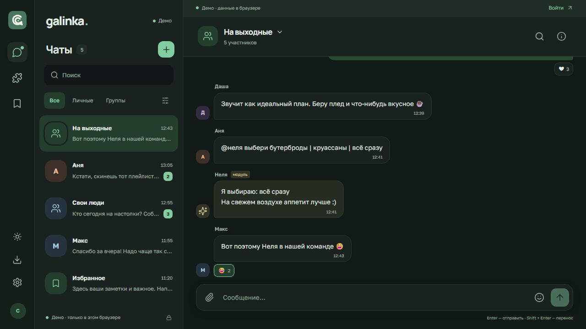
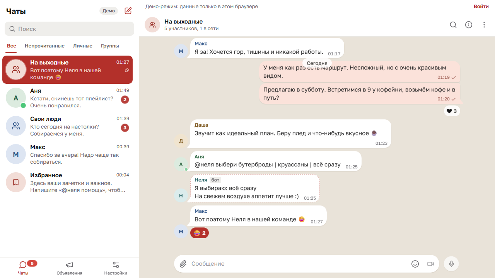

# Galinka

Мессенджер для своего круга: Android, iPhone, Windows, Linux, Arch Linux и macOS. На iPhone используется устанавливаемое веб-приложение.

[Сайт](https://mess.quiby.me) · [Веб-приложение](https://mess.quiby.me/app) · [Релизы](https://github.com/cl0rex1/Galinka/releases)



## Версия 0.5.1

- Более спокойная переписка: компактные сообщения, удобный ввод, адаптация к узким и альбомным экранам, меньше лишних анимаций.
- Набор текста не перерисовывает ленту. Возврат в недавно открытый чат восстанавливает загруженную историю и место чтения.
- Действия с сообщением открываются удержанием на телефоне или правой кнопкой мыши; свайп для ответа сохранён.
- Голосовое можно прослушать перед отправкой. Загрузка показывает прогресс, а повтор после ошибки сохраняет запись и не загружает уже принятый файл заново.
- Аудиоплеер с перемоткой, скоростью 1×/1,5×/2× и повтором загрузки. Сервер подготавливает AAC/M4A для совместимости голосовых с iPhone и остальными клиентами; исходники прежних записей сохраняются.

## Версия 0.5

- Новый интерфейс в стиле quiby.core: Onyx, фиолетовый акцент, светлая тема и анимации с настройкой уменьшения движения.
- Ответ свайпом по сообщению и возврат к чатам жестом от левого края на телефоне.
- Web Push для браузеров и установленных веб-приложений, включая iPhone/iPad с iOS 16.4+; Android использует Firebase.
- Настольные уведомления и работа в трее после закрытия окна, если системный трей доступен. Полный выход завершает получение уведомлений.
- Автоматическая загрузка обновлений Windows/AppImage с настройкой; перезапуск только по нажатию пользователя.
- Раздельная загрузка сайта, мессенджера и админки, без перерисовок React на каждом движении жеста.

## Версия 0.4

- Обновлённые список чатов, переписка и мобильная навигация; анимации учитывают настройку уменьшения движения.
- Ответы с цитатой, редактирование своих сообщений, копирование, кликабельные ссылки и отметки прочтения.
- Фото в переписке и полноэкранный просмотр; запись и воспроизведение голосовых сообщений до 5 минут.
- Личные закрепления, архив и отключение уведомлений для отдельных чатов, сохраняемые на сервере.
- Управление группой: название, добавление и удаление участников, передача владения и выход.

Для голосовой записи нужен доступ к микрофону и HTTPS (или localhost). Приложение автоматически проверяет обновления; кнопка в сайдбаре появляется при доступной новой версии.



## Версия 0.3

- Новый интерфейс чатов, короткие подписи, сведения о чате по запросу.
- Светлая, тёмная и системная темы с сохранением выбора.
- Адаптивная переписка, многострочный ввод и черновики при переключении чатов.
- Android APK с встроенным интерфейсом и подготовленной интеграцией Firebase Push.
- Windows EXE и компактный пакет Arch Linux с системным Electron.

Личные чаты, группы до 100 участников, приглашения, поиск, избранное, реакции, файлы до 20 МБ и модуль Неля сохранены. Анализ проекта и принятые решения — [docs/REDESIGN.md](docs/REDESIGN.md).

## Установка

Скачайте установщик в [GitHub Releases](https://github.com/cl0rex1/Galinka/releases/latest):

- **Android 7+:** `Galinka-0.5.1-android-release.apk`.
- **Windows x64:** `Galinka-0.5.1-win-x64.exe` (NSIS, без сертификата Microsoft).
- **Arch Linux x64:** пакет `.pkg.tar.zst`:

```sh
sudo pacman -U ./Galinka-0.5.1-arch-x64.pkg.tar.zst
```

Arch использует `electron44` из репозитория; обновления приложения устанавливаются через pacman. Рецепт makepkg — [packaging/arch/PKGBUILD](packaging/arch/PKGBUILD). Linux AppImage/DEB и macOS DMG/ZIP собирает workflow Desktop release. На iPhone доступна PWA: Safari → «Поделиться» → «На экран Домой».

**Уведомления:** включаются в «Настройки → Уведомления» на каждом устройстве. Android использует Firebase ([настройка](docs/ANDROID.md)); браузеры и PWA — Web Push ([настройка](docs/WEB-PUSH.md)). Разрешение запрашивается только после нажатия пользователя. На iPhone/iPad сначала добавьте Galinka на экран «Домой»; требуется iOS 16.4+. Настольное приложение получает сообщения, пока работает, в том числе в трее. Полное завершение приложения или выключенный компьютер прекращает настольные уведомления.

## Сервер

React 19 · TypeScript · Vite · Node.js 24 · Express 5 · PostgreSQL · Docker Compose.

Для обработки голосовых сервер использует FFmpeg и FFprobe; Docker-образ уже содержит их. При запуске Node.js вне Docker установите эти программы в `PATH` или укажите `FFMPEG_PATH` и `FFPROBE_PATH`. Для прежних записей создаётся удаляемый AAC-кэш до 128 МБ внутри каталога загрузок.

Установка на CasaOS, HTTPS, резервные копии и обновление — [docs/DEPLOY.md](docs/DEPLOY.md). Для Quiby используется `compose.edge.yml`; для Firebase добавьте `compose.push.yml` после настройки ключа.

Сообщения хранятся в PostgreSQL; LISTEN/NOTIFY и SSE обновляют открытые клиенты. Настольные приложения и APK содержат интерфейс и обращаются к `https://mess.quiby.me/messenger`. Сессии — в HttpOnly cookie. В localStorage хранятся тема, настройка пушей, черновики сообщений и явно обозначенные демоданные. При выходе черновики аккаунта удаляются. Демо: `/?demo=1`.

Сквозного шифрования, звонков и восстановления пароля через email нет. Администратор сервера имеет доступ к данным. Одна галочка означает сохранение сообщения; две — подтверждённое прочтение хотя бы одним собеседником. Квота файлов — 500 МБ на аккаунт. Перед публичным масштабированием нужны общий rate limiter и файловое хранилище.

## Разработка и проверки

```sh
npm ci
npm run setup
docker compose -f compose.yml -f compose.dev.yml up -d db
npm run dev
npm run check
npm test
npx playwright install chromium
npm run build
npm run test:e2e
```

Веб: `http://localhost:5173`. Полные API-проверки и браузерные сценарии с реальными аккаунтами запускаются только с `TEST_DATABASE_URL`, указывающим на отдельную тестовую базу. Без неё такие проверки явно пропускаются. Перед ними выполните `npm run build`. Проверяются переписка между аккаунтами, права участников, ответы и правки, медиа, архив, темы, черновики и размеры 320/375/414/768 px. Голосовые тестируются настоящим браузерным кодировщиком с синтетическим сигналом; микрофон пользователя не включается.

Регрессии переписки и загрузки: `npx playwright test tests/browser/conversation.spec.ts tests/browser/upload.spec.ts`. Они проверяют отсутствие рендера ленты при наборе, восстановление прокрутки, жесты, сохранение голосового при ошибке и повтор с прежним идентификатором отправки.

Для проверки движка Safari: `npx playwright install webkit`, затем `npx playwright test tests/browser/media.spec.ts tests/browser/mobile.spec.ts --browser=webkit`. WebKit на компьютере не заменяет проверку микрофона и воспроизведения на физическом iPhone.

```sh
npm run desktop:build -- --win
npm run arch:build
npm run android:build
npm run android:release
```

Для Android нужны JDK 21, Android SDK и `ANDROID_HOME`. Release требует ключ подписи; подробности — [docs/ANDROID.md](docs/ANDROID.md). В PowerShell для передачи флагов используйте `npm.cmd run desktop:build -- --win`. Проверка готового Windows-приложения: `node tests/desktop/smoke.cjs`.

Тег `vX.Y.Z` запускает настольные сборки и публикацию релиза. Android собирается и проверяется на эмуляторе вместе с тегом релиза; workflow также можно запустить вручную. Ключ хранится в GitHub Actions Secrets. Обновление сервера выполняется отдельно от выпуска установщиков; [docs/RELEASE.md](docs/RELEASE.md) описывает текущий выпуск.
