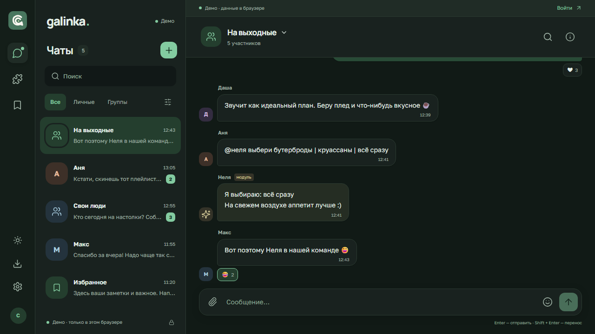

# Galinka

Мессенджер для своего круга: веб, Android, Windows и Arch Linux.

[Сайт](https://mess.quiby.me) · [Веб-приложение](https://mess.quiby.me/app) · [Релизы](https://github.com/cl0rex1/Galinka/releases)



## Версия 0.3

- Новый интерфейс чатов, короткие подписи, сведения о чате по запросу.
- Светлая, тёмная и системная темы с сохранением выбора.
- Адаптивная переписка, многострочный ввод и черновики при переключении чатов.
- Android APK с встроенным интерфейсом и подготовленной интеграцией Firebase Push.
- Windows EXE и компактный пакет Arch Linux с системным Electron.

Личные чаты, группы до 100 участников, приглашения, поиск, избранное, реакции, файлы до 20 МБ и модуль Неля сохранены. Анализ проекта и принятые решения — [docs/REDESIGN.md](docs/REDESIGN.md).

## Установка

Скачайте установщик в [GitHub Releases](https://github.com/cl0rex1/Galinka/releases/latest):

- **Android 7+:** `Galinka-0.3.2-android-release.apk`.
- **Windows x64:** `Galinka-0.3.2-win-x64.exe` (NSIS, без сертификата Microsoft).
- **Arch Linux x64:** пакет `.pkg.tar.zst`:

```sh
sudo pacman -U ./Galinka-0.3.2-arch-x64.pkg.tar.zst
```

Arch использует `electron44` из репозитория; обновления приложения устанавливаются через pacman. Рецепт makepkg — [packaging/arch/PKGBUILD](packaging/arch/PKGBUILD). Linux AppImage/DEB и macOS DMG/ZIP собирает workflow Desktop release. На iPhone доступна PWA: Safari → «Поделиться» → «На экран Домой».

**Android Push подключён к Firebase:** установите APK 0.3.2+, войдите в аккаунт и включите «Настройки → Уведомления». Android должен разрешить уведомления. Настройка и обслуживание — [docs/ANDROID.md](docs/ANDROID.md). Фоновые уведомления веб-версии и закрытого настольного приложения не реализованы.

## Сервер

React 19 · TypeScript · Vite · Node.js 24 · Express 5 · PostgreSQL · Docker Compose.

Установка на CasaOS, HTTPS, резервные копии и обновление — [docs/DEPLOY.md](docs/DEPLOY.md). Для Quiby используется `compose.edge.yml`; для Firebase добавьте `compose.push.yml` после настройки ключа.

Сообщения хранятся в PostgreSQL; LISTEN/NOTIFY и SSE обновляют открытые клиенты. Настольные приложения и APK содержат интерфейс и обращаются к `https://mess.quiby.me/messenger`. Сессии — в HttpOnly cookie. В localStorage хранятся тема, настройка пушей и явно обозначенные демоданные. Демо: `/?demo=1`.

Сквозного шифрования, звонков и восстановления пароля через email нет. Администратор сервера имеет доступ к данным. Галочка означает сохранение сообщения, а не прочтение. Квота файлов — 500 МБ на аккаунт. Перед публичным масштабированием нужны общий rate limiter и файловое хранилище.

## Разработка и проверки

```sh
npm ci
npm run setup
docker compose -f compose.yml -f compose.dev.yml up -d db
npm run dev
npm run check
npm test
npx playwright install chromium
npm run test:e2e
npm run build
```

Веб: `http://localhost:5173`. Полные API-проверки запускаются только с `TEST_DATABASE_URL`, указывающим на отдельную тестовую базу. Без неё этот тест явно пропускается. Браузерные проверки покрывают чаты, Нелю, темы, черновики, настройки и размеры 320/375/414/768 px.

```sh
npm run desktop:build -- --win
npm run arch:build
npm run android:build
npm run android:release
```

Для Android нужны JDK 21, Android SDK и `ANDROID_HOME`. Release требует ключ подписи; подробности — [docs/ANDROID.md](docs/ANDROID.md). В PowerShell для передачи флагов используйте `npm.cmd run desktop:build -- --win`. Проверка готового Windows-приложения: `node tests/desktop/smoke.cjs`.

Тег `vX.Y.Z` запускает настольные сборки и публикацию релиза. Android собирается и проверяется на эмуляторе вместе с тегом релиза; workflow также можно запустить вручную. Ключ хранится в GitHub Actions Secrets. Обновление сервера выполняется отдельно от выпуска установщиков; [docs/RELEASE.md](docs/RELEASE.md) описывает текущий выпуск.
